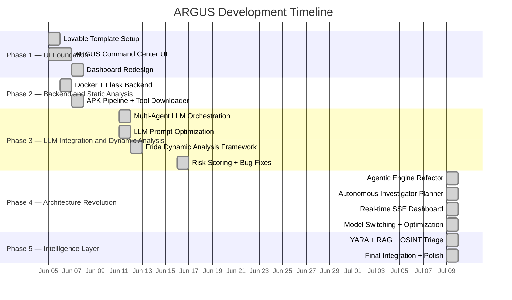
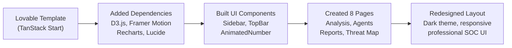
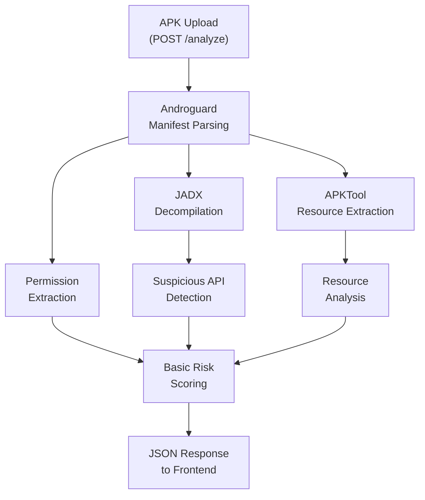
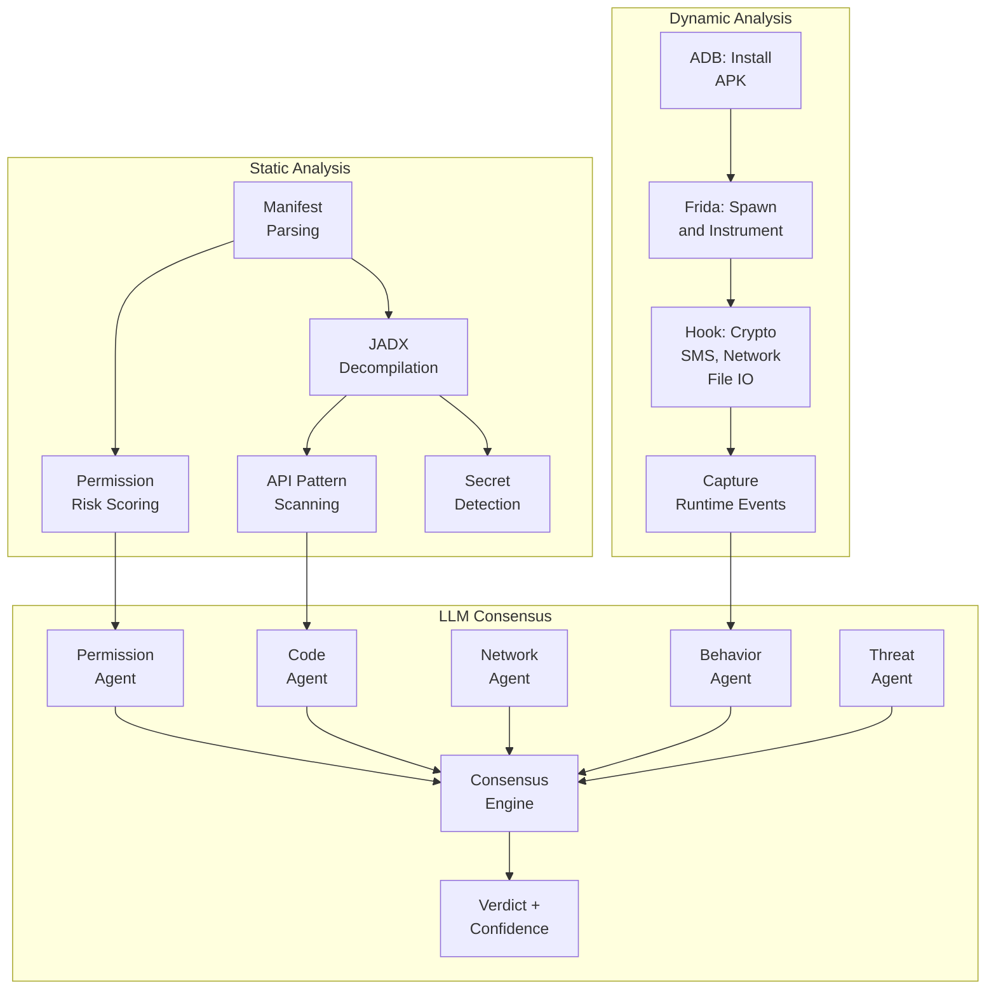
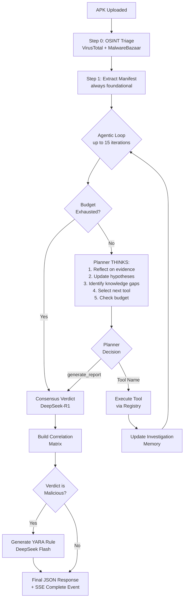
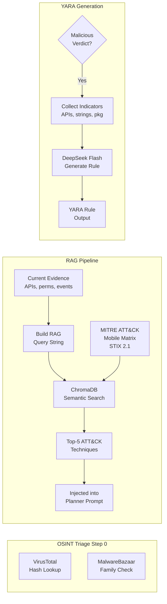
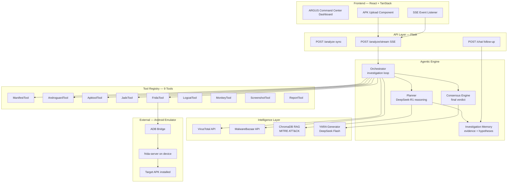
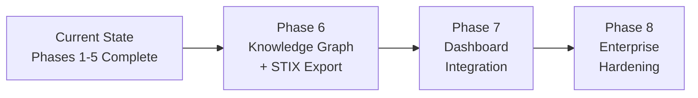

# 🛡️ ARGUS — SENTINEL APK: Development Progress Report

> **Project**: ARGUS Eye Guard — GenAI-Powered Autonomous Android Malware Analysis Platform
> **Team**: danishistired (Danish)
> **Repository**: `danishistired/argus-eye-guard`
> **Development Period**: June 5, 2026 — July 10, 2026 (36 days)
> **Report Date**: July 10, 2026
> **Total Commits**: 36 across 4 branches
> **Total Source Files Created**: 93+

---

## Table of Contents

1. [Executive Summary](#executive-summary)
2. [Project Vision and Problem Statement](#project-vision-and-problem-statement)
3. [Development Timeline — Chronological History](#development-timeline--chronological-history)
4. [Phase-by-Phase Breakdown](#phase-by-phase-breakdown)
5. [Architecture Deep Dive](#architecture-deep-dive)
6. [Technology Stack](#technology-stack)
7. [Code Metrics and Repository Statistics](#code-metrics-and-repository-statistics)
8. [Key Technical Innovations](#key-technical-innovations)
9. [Current System Status](#current-system-status)
10. [Challenges Encountered and Solutions](#challenges-encountered-and-solutions)
11. [Future Roadmap](#future-roadmap)

---

## Executive Summary

**ARGUS (Autonomous Reverse-engineering Guardian for Unified Security)** is a GenAI-powered autonomous malware analysis platform that investigates Android APK files using an agentic AI architecture. Unlike traditional scanners that follow rigid pipelines, ARGUS employs an **AI-driven investigation engine** where a DeepSeek-R1 powered planner dynamically decides which analysis tools to run based on accumulated evidence — mimicking how a human security analyst thinks.

Over 36 days of intensive development, the project evolved through **5 major phases**, underwent a **complete architectural pivot** from a fixed pipeline to an agentic investigation engine, and grew from a basic UI scaffold into a fully functional system with:

- **15 specialized analysis tools** (static + dynamic + OSINT)
- **RAG-enhanced reasoning** grounded in the MITRE ATT&CK Mobile framework
- **Real-time SSE streaming** dashboard with live investigation progress
- **Automated YARA rule generation** for detected threats
- **Evidence correlation engine** linking static code findings to runtime behavior

The system has been tested against real-world APKs including InsecureBankv2 and WildFire test samples.

---

## Project Vision and Problem Statement

### The Problem

Mobile banking fraud through malicious Android applications is a rapidly growing threat. Existing solutions suffer from:

1. **Rigid pipeline scanners** — run every tool on every APK regardless of what is relevant
2. **No reasoning capability** — tools produce data but nobody interprets it holistically
3. **High false positive rates** — static analysis alone flags benign apps as dangerous
4. **No evidence correlation** — static findings (code exists) are not validated against runtime behavior (code actually executes)
5. **Speculative reporting** — outputs use vague language like "may indicate" instead of evidence-based conclusions

### The ARGUS Solution

An **autonomous AI investigator** that:
- Dynamically selects analysis tools based on evidence (not a fixed checklist)
- Forms hypotheses, tracks knowledge gaps, and evolves confidence across iterations
- Correlates static code capabilities with dynamic runtime observations
- Produces evidence-based verdicts with zero speculative language
- Generates actionable detection artifacts (YARA rules) for confirmed threats

---

## Development Timeline — Chronological History

### Visual Timeline



### Commit-by-Commit History

| # | Date | Time | Commit | Description |
|---|------|------|--------|-------------|
| 1 | Jun 5 | 20:53 | `dece974` | Initial dependency setup — added D3.js, Framer Motion, Recharts |
| 2 | Jun 5 | 20:53 | `11e95d7` | Removed default index route to prepare for ARGUS layout |
| 3 | Jun 5 | 20:54 | `3720645` | Created ARGUS UI scaffold — Sidebar, TopBar, AnimatedNumber components |
| 4 | Jun 5 | 20:54 | `a34486d` | Route tree cleanup |
| 5 | Jun 5 | 20:57 | `9f721e1` | Built all 8 ARGUS dashboard pages — Analysis, Agents, Reports, Knowledge Graph, Threat Map, Submissions, Settings |
| 6 | Jun 5 | 20:57 | `45518d0` | Route tree fixes |
| 7 | Jun 5 | 20:57 | `260595a` | **Merged: "Added ARGUS command center"** — complete frontend scaffold |
| 8 | Jun 6 | 20:32 | `d91df12` | Created Docker instance + Flask backend, added implementation_plan.md (748 lines), phases.md, InsecureBankv2 test APK |
| 9 | Jun 7 | 12:52 | `e09b7d0` | Frontend dependency updates |
| 10 | Jun 7 | 12:52 | `2a0c6b8` | Root layout adjustments |
| 11 | Jun 7 | 12:53 | `8c22473` | **Major dashboard expansion** — +677 lines to main analysis page |
| 12 | Jun 7 | 12:54 | `fe65305` | UI polish and changes |
| 13 | Jun 7 | 12:54 | `e98a0f3` | **Merged: "Redesigned workspace UI"** |
| 14 | Jun 7 | 20:07 | `1dea618` | **BACKEND BORN**: APK analysis pipeline with automated tool downloader (JADX, APKTool) and Flask backend |
| 15 | Jun 11 | 04:42 | `b60c147` | **LLM INTEGRATION**: Multi-agent LLM orchestration with sandboxing — the first version of AI-powered analysis |
| 16 | Jun 11 | 18:23 | `23c8c33` | Optimized data sent to LLM — reduced noise, improved signal quality |
| 17 | Jun 12 | 00:25 | `d4a1773` | **DYNAMIC ANALYSIS**: Frida hooking framework + sandbox orchestration service |
| 18 | Jun 16 | 16:07 | `1fc4a5b` | Fixed JSON parsing errors, new risk scoring formula, reduced LLM noise |
| 19 | Jun 16 | 16:09 | `040e4b4` | Additional fixes |
| 20 | Jun 16 | 16:11 | `8987fae` | Gitignore updates |
| 21 | Jun 16 | 16:18 | `2203869` | Cleanup |
| 22 | Jul 9 | 09:51 | `8f36e42` | Gitignore updates for new phase |
| 23 | Jul 9 | 10:24 | `ff6966e` | **ARCHITECTURE REVOLUTION**: Replaced pipeline-driven architecture with agentic investigation engine — the 1633-line monolith decomposed into modular engine/tools/shared layers |
| 24 | Jul 9 | 10:56 | `281af6e` | **AUTONOMOUS INVESTIGATOR**: Evolved planner into autonomous investigator with structured reasoning, hypothesis tracking, knowledge gaps |
| 25 | Jul 9 | 12:44 | `584a944` | **REAL-TIME DASHBOARD**: APK analysis dashboard with SSE progress tracking and agent-based reporting |
| 26 | Jul 9 | 14:59 | `8fee243` | Cache file management |
| 27 | Jul 9 | 15:08 | `2c0124e` | Model switching and optimization |
| 28 | Jul 9 | 15:09 | `d81aa7b` | **Merged PR #1: feature/architecture-change** — the complete agentic engine |
| 29 | Jul 9 | 23:31 | `e8db8e0` | **INTELLIGENCE LAYER**: YARA rules, RAG with MITRE ATT&CK vectors, OSINT Triage (VirusTotal + MalwareBazaar), prompt optimization |
| 30 | Jul 9 | 23:33 | `02100cb` | **Merged PR #2: feature/phase-4** — intelligence and threat detection capabilities |
| 31 | Jul 9 | 23:43 | `c305b7a` | Integration polish |
| 32 | Jul 9 | 23:47 | `1e92280` | **HEAD** — current state |

---

## Phase-by-Phase Breakdown

### Phase 1: UI Foundation and Project Scaffolding (June 5-7)

**Objective**: Create the ARGUS Command Center dashboard — a professional-grade security operations interface.

**What was built**:
- Full React + TanStack Router + Tailwind CSS dashboard
- 8 dedicated pages: Analysis, Agents, Reports, Knowledge Graph, Threat Map, Submissions, Settings, Index
- Custom components: Sidebar navigation, TopBar, AnimatedNumber
- D3.js integration for future data visualizations
- Framer Motion for UI animations
- Recharts for data charting

**Key commits**: `dece974` to `e98a0f3` (13 commits, 2 merge commits)

**Lines of code added**: ~8,000+ (frontend scaffold)



---

### Phase 2: Backend Foundation and Static Analysis (June 6-7)

**Objective**: Stand up the analysis backend — Flask API, Docker container, APK parsing, and static analysis tooling.

**What was built**:
- Flask API server (`analysis/app.py`) with CORS support
- Docker containerization (`Dockerfile` + `docker-compose.yml`)
- Automated tool downloader script (`download_tools.ps1`) for JADX and APKTool
- APK upload endpoint (`POST /analyze`)
- Androguard integration for manifest parsing
- JADX integration for Java decompilation
- APKTool integration for resource extraction
- Basic permission extraction and risk flagging
- Test APK samples: InsecureBankv2.apk, test-sample.apk

**Key commits**: `d91df12` to `1dea618`



---

### Phase 3: LLM Integration and Dynamic Analysis (June 11-16)

**Objective**: Add AI-powered analysis using LLMs, runtime instrumentation with Frida, and evidence correlation.

**What was built**:

#### Multi-Agent LLM Orchestration (June 11)
- DeepSeek API integration via OpenAI-compatible client
- Multi-agent analysis structure: Permission Agent, Code Agent, Network Agent, Behavior Agent, Threat Agent
- Consensus verdict generation with structured JSON output
- LLM prompt engineering for evidence-based reasoning

#### Dynamic Analysis Framework (June 12)
- `SandboxOrchestrator` class (365 lines) — full Frida lifecycle management
- Automated frida-server download, push, and startup on Android emulator
- APK install, launch, instrument, monitor, cleanup pipeline
- Frida hooks script (`hooks-src.js`, 106 lines) monitoring:
  - Cryptography operations (Cipher.init, Cipher.doFinal)
  - OS command execution (Runtime.exec)
  - SMS sending (SmsManager.sendTextMessage)
  - Network connections (java.net.URL)
  - Base64 decoding (obfuscation detection)
  - File I/O operations (java.io.File)
- Spawn mode (primary) + attach-with-retry (fallback) strategies
- frida-compile integration for bundled hook scripts

#### Prompt and Scoring Optimization (June 16)
- Fixed JSON parsing errors from LLM responses
- New risk scoring formula with weighted categories
- Reduced noise being sent to LLM (library code filtering)
- Signal level classification: HIGH / MEDIUM / LOW

**Key commits**: `b60c147` to `2203869`



---

### Phase 4: The Architecture Revolution (July 9 — Morning)

> **This was the pivotal moment in the project.** In a single day, the entire backend was refactored from a 1,633-line monolithic Flask app into a modular, agentic investigation engine.

**Objective**: Replace the rigid pipeline architecture with an autonomous AI investigator that dynamically decides what to analyze.

**What changed — The Monolith Decomposition**:

| Before (Monolith) | After (Agentic Engine) |
|---|---|
| 1 file: `app.py` (1,633 lines) | 4 packages, 25+ files |
| Fixed pipeline: always run all tools | Dynamic: AI decides which tools to run |
| No reasoning: tools produce data | Full reasoning: reflection, hypotheses, knowledge gaps |
| No memory: each tool is independent | Investigation memory accumulates evidence |
| No budget: everything runs regardless | Cost-aware budget system (30 units max) |

**New Architecture — 4 Packages**:

```
analysis/
  engine/                        # The Agentic Brain
    orchestrator.py (528 lines)  - Investigation loop coordinator
    planner.py (280 lines)       - DeepSeek-R1 autonomous reasoner
    memory.py (427 lines)        - Evidence accumulation and state
    prompts.py (231 lines)       - Centralized LLM prompt library

  tools/                         # 9 Auto-Registered Investigation Tools
    base.py (106 lines)          - Abstract tool interface
    registry.py (109 lines)      - Auto-discovery and registration
    manifest_tool.py             - APK manifest extraction
    androguard_tool.py           - Deep permission analysis
    apktool_tool.py              - Resource and smali analysis
    jadx_tool.py                 - Source code decompilation
    frida_tool.py                - Dynamic instrumentation
    logcat_tool.py               - Android system log capture
    monkey_tool.py               - UI exerciser for code coverage
    screenshot_tool.py           - Runtime screenshot capture
    report_tool.py               - Final report generation

  shared/                        # Cross-Cutting Utilities
    constants.py (221 lines)     - Detection patterns and scoring weights
    evidence.py (379 lines)      - Evidence preprocessing and correlation
    language.py (272 lines)      - LLM output parsing and enforcement
    scoring.py (64 lines)        - Rule-based risk scoring engine

  rag/                           # RAG Knowledge Base
    retriever.py (118 lines)     - Semantic technique retrieval
    mitre_loader.py (201 lines)  - MITRE ATT&CK STIX ingestion
    chroma_store.py              - ChromaDB vector store management
    mobile_attack_cache.json     - Cached ATT&CK Mobile matrix (74KB)

  app.py (315 lines)             # Slim Flask API (routes only)
  sandbox.py (365 lines)         # Frida sandbox orchestrator
```

**The Investigation Loop — How It Works**:



**Tool Budget System**:

| Cost Level | Units | Tools |
|---|---|---|
| very_low (1 unit) | 1 | Manifest, Permissions, Logcat, Screenshot |
| low (2 units) | 2 | APKTool |
| medium (4 units) | 4 | JADX |
| high (6 units) | 6 | Frida, Monkey |
| **Total Budget** | **30** | All tools combined |

**Key commits**: `ff6966e` to `d81aa7b` (PR #1 merged)

---

### Phase 5: Intelligence Layer — RAG, OSINT, YARA (July 9 — Evening)

**Objective**: Add threat intelligence capabilities — external reputation checks, knowledge-grounded reasoning, and automated detection artifact generation.

**What was built**:

#### OSINT Triage (Step 0 — before any analysis)
- **VirusTotal Tool** (158 lines): SHA-256 hash lookup against 70+ AV engines. Returns detection ratio, malware family tags, first-seen dates. If detection rate exceeds 50%, sets KNOWN_MALICIOUS signal for fast-track verdict.
- **MalwareBazaar Tool**: Hash lookup against abuse.ch malware sample database. Returns known family classification and community tags.

#### RAG — Retrieval-Augmented Generation
- **MITRE ATT&CK Mobile Loader** (201 lines): Downloads the full MITRE ATT&CK Mobile STIX 2.1 bundle, parses all attack-pattern objects, and embeds them into ChromaDB using all-MiniLM-L6-v2 sentence transformer.
- **Cached Matrix**: 74KB mobile_attack_cache.json containing all mobile techniques for offline use.
- **Semantic Retriever** (118 lines): At every planner iteration, builds a query from current evidence (suspicious APIs, permissions, runtime events) and retrieves the top-5 most relevant ATT&CK techniques. These are injected into the planner system prompt as grounding context.
- **Background Initialization**: RAG collection is populated in a background thread at startup.

#### YARA Rule Generation
- **YARA Tool** (144 lines): After a malicious or high-risk verdict, automatically generates a YARA detection rule from the specific indicators found (APIs, hardcoded strings, package patterns). Uses deepseek-v4-flash for fast generation (under 2 seconds).

**Key commit**: `e8db8e0` to `02100cb` (PR #2 merged)



---

## Architecture Deep Dive

### System Architecture Overview



### The Evidence Correlation Engine

One of ARGUS's key innovations is the **deterministic correlation engine** that links static code findings to runtime behavior — no LLM needed for this step.

| Static Finding | Maps To | Dynamic Event | Result |
|---|---|---|---|
| SmsManager in AppCode.java | sms | "Sending SMS to +1234" | VALIDATED |
| Runtime.exec in Utils.java | command_execution | "Runtime.exec('su')" | VALIDATED |
| DexClassLoader in Loader.java | file_access | (no events captured) | NOT_VALIDATED |
| HttpURLConnection in Net.java | network | (sandbox not run) | NOT_TESTED |

### LLM Model Routing Strategy

| Task Type | Model | Reasoning |
|---|---|---|
| **Planner decisions** | deepseek-reasoner (R1) | Needs chain-of-thought for multi-step reasoning |
| **Consensus verdict** | deepseek-reasoner (R1) | Must synthesize full investigation memory |
| **Chat follow-up** | deepseek-v4-flash | Low-latency single-turn conversation |
| **YARA generation** | deepseek-v4-flash | Fast, deterministic code generation |

---

## Technology Stack

### Backend

| Technology | Purpose | Where Used |
|---|---|---|
| Python 3.11+ | Core backend language | All analysis code |
| Flask | REST API server | analysis/app.py |
| DeepSeek API | LLM reasoning engine | Planner, Consensus, Chat, YARA |
| OpenAI Python SDK | DeepSeek API client | LLM integration layer |
| Androguard | APK manifest/permission parsing | androguard_tool.py, manifest_tool.py |
| JADX | Java decompilation | jadx_tool.py |
| APKTool | Smali/resource extraction | apktool_tool.py |
| Frida | Dynamic runtime instrumentation | frida_tool.py, sandbox.py |
| ChromaDB | Vector store for RAG | rag/chroma_store.py |
| sentence-transformers | Embedding model (MiniLM-L6-v2) | ChromaDB default embeddings |
| VirusTotal API v3 | OSINT hash reputation | virustotal_tool.py |
| MalwareBazaar API | Malware family lookup | malwarebazaar_tool.py |

### Frontend

| Technology | Purpose |
|---|---|
| React 19 | UI framework |
| TanStack Router | File-based routing |
| TanStack Query | Data fetching |
| Tailwind CSS 4 | Styling |
| D3.js 7 | Data visualizations |
| Framer Motion | Animations |
| Recharts | Chart components |
| Radix UI | Accessible component primitives |
| Lucide React | Icon library |
| Vite 7 | Build tool and dev server |

### Infrastructure

| Technology | Purpose |
|---|---|
| Docker | Containerized deployment |
| ADB | Android Debug Bridge |
| frida-server | On-device instrumentation daemon |
| Android Emulator | Sandboxed APK execution |

---

## Code Metrics and Repository Statistics

### Repository Overview

| Metric | Value |
|---|---|
| Total commits | 36 |
| Branches | 4 (main, feature/architecture-change, feature/phase-4, template) |
| Pull Requests merged | 2 |
| Development duration | 36 days (Jun 5 — Jul 10) |
| Active coding days | ~8 intense days |
| Contributors | 1 (danishistired) + Lovable AI (initial UI generation) |

### Code Volume by Package

| Package | Files | Key File Sizes | Purpose |
|---|---|---|---|
| analysis/engine/ | 5 | orchestrator (528L), memory (427L), planner (280L), prompts (231L) | Agentic investigation brain |
| analysis/tools/ | 15 | apktool (16KB), jadx (6.8KB), manifest (7.1KB) | Investigation tool wrappers |
| analysis/shared/ | 5 | evidence (379L), language (272L), constants (221L) | Cross-cutting utilities |
| analysis/rag/ | 5 | mitre_loader (201L), cache (74KB) | RAG knowledge base |
| analysis/ root | 3 | app (315L), sandbox (365L), hooks-src (106L) | API server + Frida sandbox |
| src/routes/ | 11 | _argus.index.tsx (58KB) | Frontend dashboard pages |
| src/components/ | 50+ | ui/ (Radix primitives), argus/ (custom) | React components |

### Test APK Samples in Repository

| Sample | Size | Purpose |
|---|---|---|
| InsecureBankv2.apk | 3.4 MB | Intentionally vulnerable banking app |
| app-debug.apk | 1.1 MB | Debug build test sample |
| wildfire-test-apk-file.apk | 1.4 MB | WildFire malware test sample |
| test-sample.apk | 14 bytes | Placeholder test file |

---

## Key Technical Innovations

### 1. Agentic Investigation (Not a Pipeline)

Traditional malware scanners run a fixed sequence: decompile, scan, report. ARGUS is fundamentally different — the AI **decides** what to do based on what it has found so far.

**Example investigation paths**:
- **Benign app**: Manifest -> Permissions -> "No dangerous permissions, confidence 80%, generating report" (3 steps, budget: 3 units)
- **Suspicious app**: Manifest -> Permissions -> JADX (found SmsManager) -> Frida (validate SMS at runtime) -> Monkey (exercise more code) -> Report (7 steps, budget: 18 units)
- **Known malware**: OSINT (VT: 48/72 detection) -> Manifest -> Report with high confidence (3 steps, fast-track)

### 2. Hypothesis-Driven Reasoning

The planner maintains evolving hypotheses about the APK:

- Iteration 2: "This app has SMS interception capabilities" (confidence: 45%, unconfirmed)
- Iteration 4: "This app has SMS interception capabilities" (confidence: 85%, confirmed)
  - Supporting: SmsManager in code + RECEIVE_SMS permission + SMS hook triggered at runtime

### 3. Language Enforcement — Zero Speculation

Every LLM output passes through a language enforcement layer that strips speculative phrases:
- "This app **may** be malicious" becomes "This app **is** malicious"
- "The SMS code **suggests** data theft" becomes "The SMS code **evidence shows** data theft"
- "**Potentially** dangerous" becomes simply "Dangerous"

### 4. Truncated JSON Repair

LLMs sometimes run out of tokens mid-response. ARGUS has a 3-stage JSON repair system:
1. Direct parse attempt
2. Repair truncated JSON (close unclosed strings, brackets, braces)
3. Progressive trimming to find parseable subset

### 5. RAG-Grounded Threat Intelligence

The planner reasoning is grounded in real MITRE ATT&CK techniques, not hallucinated threat knowledge. At every iteration, the RAG retriever pulls the most relevant techniques based on current evidence and injects them as context.

---

## Current System Status

### What Works End-to-End

| Capability | Status | Notes |
|---|---|---|
| APK upload via REST API | Working | /analyze and /analyze/stream |
| OSINT triage (VT + MB) | Working | Requires API keys in .env |
| Manifest extraction | Working | Androguard-based |
| Deep permission analysis | Working | 20 high-risk permissions tracked |
| JADX source decompilation | Working | Suspicious API + secret scanning |
| APKTool resource analysis | Working | Smali, native libs, secondary DEX |
| Frida dynamic analysis | Working | Requires Android emulator + ADB |
| Monkey UI exerciser | Working | Triggers more code paths for Frida |
| Evidence correlation | Working | Deterministic static to dynamic matching |
| Agentic investigation loop | Working | DeepSeek-R1 powered planning |
| RAG with MITRE ATT&CK | Working | ChromaDB + MiniLM embeddings |
| YARA rule generation | Working | Auto-generated for malicious verdicts |
| LLM consensus verdict | Working | Evidence-based, calibrated confidence |
| SSE real-time streaming | Working | Live progress to frontend |
| Chat follow-up Q&A | Working | Context-aware, evidence-only answers |
| Frontend dashboard | Working | React + TanStack + Tailwind |
| Risk scoring engine | Working | Weighted, capped per category |
| Language enforcement | Working | Zero speculative language in output |
| Prompt audit logging | Working | All LLM prompts logged to disk |

### Planned but Not Yet Implemented

| Capability | Phase | Notes |
|---|---|---|
| Neo4j Knowledge Graph | Phase 6 | STIX 2.1 ontology designed |
| STIX 2.1 bundle export | Phase 6 | Schema defined in implementation plan |
| Sigma rule generation | Phase 6 | Alongside YARA |
| WebSocket live updates | Phase 7 | Currently using SSE (works well) |
| D3.js threat map visualization | Phase 7 | Page exists, needs data wiring |
| Blockchain audit trail | Phase 8 | Hyperledger Fabric planned |
| Federated learning | Phase 8 | Cross-bank model training |
| ML classification ensemble | Phase 3 planned | XGBoost + GNN + Transformer designed |

---

## Challenges Encountered and Solutions

### 1. The Monolith Problem
**Challenge**: By Phase 3, app.py had grown to 1,633 lines — analysis logic, API routes, LLM prompts, tool management, and scoring all in one file. Adding new features was becoming painful.

**Solution**: The Phase 4 architecture revolution decomposed the monolith into 4 packages with clear boundaries. The Flask app shrank from 1,633 lines to 315 lines (routes only).

### 2. LLM JSON Parsing Failures
**Challenge**: DeepSeek models would sometimes return truncated JSON (ran out of tokens), include markdown fences, or prepend explanatory text before the JSON.

**Solution**: Built a 3-stage JSON repair system in language.py that handles all these cases. Also added retry logic with slightly increased temperature on failures.

### 3. Frida Attachment Race Condition
**Challenge**: When launching an APK via ADB and then attaching Frida, the process would sometimes crash or exit before Frida could attach.

**Solution**: Implemented dual-strategy instrumentation: primary spawn mode (Frida starts the app suspended, injects hooks, then resumes) and fallback attach-with-retry (up to 3 attempts with exponential backoff).

### 4. Library Code Noise
**Challenge**: JADX decompiles everything including library code (androidx, OkHttp, Google Play Services). Scanning all of it floods the LLM with irrelevant findings.

**Solution**: Built a library path prefix filter (LIBRARY_PATH_PREFIXES in constants.py) that identifies and de-prioritizes findings from known library packages. Each finding is tagged with is_library: true/false.

### 5. LLM Hallucination in Verdicts
**Challenge**: Without grounding, the LLM would sometimes fabricate evidence or use speculative language that implied threats not supported by actual findings.

**Solution**: Three-pronged approach:
1. RAG grounding — planner sees real MITRE ATT&CK techniques, not hallucinated ones
2. Language enforcement — post-processing strips all speculative phrases
3. Evidence-based prompts — strict prompt rules requiring citation of specific evidence

---

## Future Roadmap

### Immediate Next Steps (Phases 6-8)



**Phase 6**: Neo4j knowledge graph with STIX 2.1 ontology, Sigma rule generation, comprehensive reporting

**Phase 7**: Wire the Lovable dashboard frontend to backend APIs, WebSocket connections for real-time updates, D3.js visualizations

**Phase 8**: Audit trails for compliance, performance optimization across the entire pipeline, federated learning for cross-deployment model improvement

### Vision: Full Multi-Agent Consensus

The current system uses a single planner + consensus engine. The full vision (detailed in implementation_plan.md) includes **6 specialized AI agents** that independently analyze the APK and go through an **adversarial consensus protocol** — challenging each other claims before reaching a verdict.

---

## Conclusion

ARGUS has evolved from a UI scaffold to a fully functional, AI-powered autonomous malware analysis platform in 36 days. The key differentiator is not just *what* tools it uses, but *how* it uses them — an agentic architecture where the AI reasons about evidence, forms hypotheses, and dynamically selects the most valuable next step rather than blindly running every tool on every APK.

The system is operational, tested against real APK samples, and produces evidence-based verdicts with automated detection artifacts. With the intelligence layer (RAG + OSINT + YARA) now in place, ARGUS represents a genuinely novel approach to mobile malware analysis — one that thinks like an analyst, not a scanner.

---

> *"This is not a scanner. This is an autonomous cybersecurity analyst."*
> — ARGUS Implementation Plan, June 6, 2026
