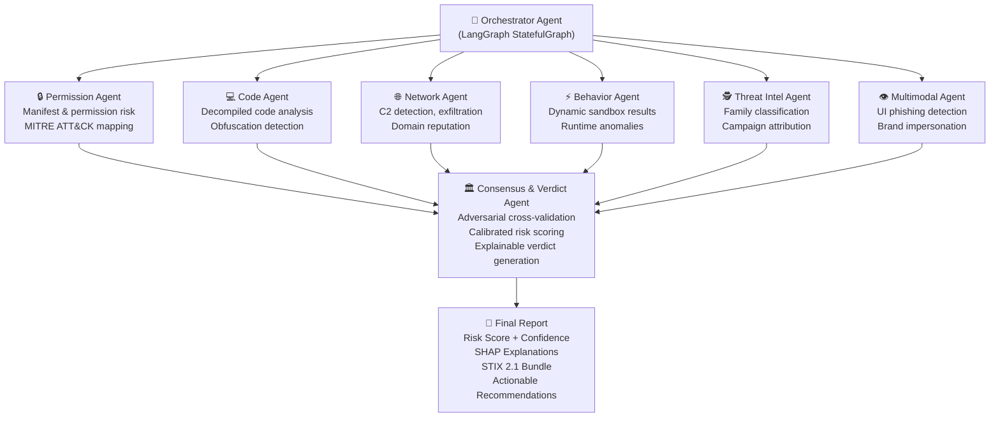
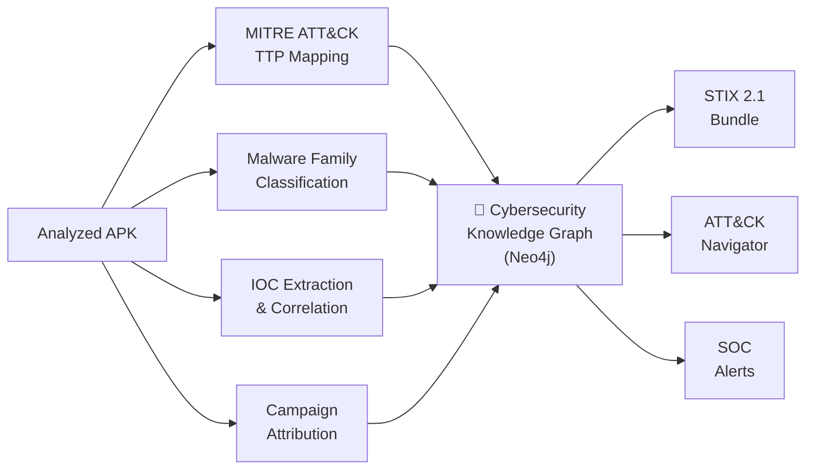

# 🛡️ SENTINEL APK — GenAI-Powered Autonomous Malware Analysis & Risk Scoring Platform

> **Codename: SENTINEL APK** — A next-generation, multi-agent AI system that autonomously reverse-engineers, detonates, classifies, and scores fraudulent Android applications with human-expert-level precision and machine-speed execution.

---

## Executive Vision

This is not a scanner. This is an **autonomous cybersecurity analyst** — a multi-agent AI system where specialized AI agents collaborate through adversarial consensus to dissect APKs across 7 analysis dimensions simultaneously, producing court-admissible, regulation-compliant verdicts with explainable reasoning in under 3 minutes.

The system combines:
- 🧠 **6 Specialized AI Agents** working in adversarial consensus (inspired by SentinelOne's architecture)
- 🔬 **7-Layer Deep Analysis Pipeline** (static → dynamic → network → behavioral → intelligence → AI reasoning → verdict)
- 📊 **Hybrid ML Ensemble** (XGBoost + GNN + Transformer + Meta-Classifier) with calibrated confidence scoring
- 🗂️ **RAG-Enhanced Knowledge Base** grounded in MITRE ATT&CK Mobile, CVE/CWE databases, and malware family intelligence
- 🔗 **Cybersecurity Knowledge Graph** (Neo4j) linking APKs → TTPs → Actors → Campaigns → Infrastructure
- 🏦 **Banking-Grade Compliance** (PCI-DSS, SOC 2, RBI, DORA, EU AI Act) with blockchain-backed immutable audit trails

---

## System Architecture Overview

```
┌──────────────────────────────────────────────────────────────────────────────────────┐
│                              SENTINEL APK — SYSTEM ARCHITECTURE                       │
│                                                                                      │
│  ┌────────────────────────────────────────────────────────────────────────────────┐   │
│  │                         🌐 INTAKE & TRIAGE GATEWAY                            │   │
│  │  REST API (Upload) │ GraphQL (Reports) │ Webhooks │ Email/SMS Phishing Feeds  │   │
│  │  Pre-signed S3 URLs │ Hash Deduplication │ Rate Limiting │ OAuth 2.0/OIDC     │   │
│  └──────────────────────────────────┬─────────────────────────────────────────────┘   │
│                                     │                                                │
│  ┌──────────────────────────────────▼─────────────────────────────────────────────┐   │
│  │                    📡 EVENT STREAMING BACKBONE (Apache Kafka)                  │   │
│  │  Topics: raw-submissions │ validated-apks │ static-results │ dynamic-results  │   │
│  │          ml-features │ ai-verdicts │ threat-intel │ final-reports              │   │
│  │  Exactly-once semantics │ Partitioned by SHA-256 │ Consumer Groups            │   │
│  └──┬──────────┬──────────┬──────────┬──────────┬──────────┬─────────────────────┘   │
│     │          │          │          │          │          │                           │
│  ┌──▼───┐  ┌──▼───┐  ┌──▼───┐  ┌──▼───┐  ┌──▼───┐  ┌──▼──────────────────────┐   │
│  │LAYER │  │LAYER │  │LAYER │  │LAYER │  │LAYER │  │LAYER 6                  │   │
│  │  1   │  │  2   │  │  3   │  │  4   │  │  5   │  │ MULTI-AGENT AI ENGINE   │   │
│  │OSINT │  │STATIC│  │DYNAMI│  │NET-  │  │THREA │  │                         │   │
│  │TRIAGE│  │ANALY │  │C SAND│  │WORK  │  │T     │  │ ┌─────────────────────┐ │   │
│  │      │  │SIS   │  │BOX   │  │FORENS│  │INTEL │  │ │  🤖 ORCHESTRATOR    │ │   │
│  │VT API│  │      │  │      │  │ICS   │  │      │  │ │     AGENT           │ │   │
│  │Malwar│  │Andro-│  │CAPE  │  │mitm- │  │MITRE │  │ └──┬──┬──┬──┬──┬─────┘ │   │
│  │Bazaar│  │guard │  │Sandbox│  │proxy │  │ATT&CK│  │    │  │  │  │  │       │   │
│  │Intel │  │JADX  │  │Frida │  │Wire- │  │DroidT│  │ ┌──▼┐┌▼─┐┌▼─┐┌▼─┐┌▼──┐│   │
│  │Owl   │  │Ghidra│  │ANY.RU│  │shark │  │TP    │  │ │P  ││C ││N ││B ││TI ││   │
│  │APKiD │  │MobSF │  │N     │  │Frida │  │YARA  │  │ │A  ││A ││A ││A ││A  ││   │
│  │      │  │Quark │  │      │  │Stalke│  │STIX  │  │ │   ││  ││  ││  ││   ││   │
│  │      │  │      │  │      │  │r     │  │      │  │ └───┘└──┘└──┘└──┘└───┘│   │
│  └──────┘  └──────┘  └──────┘  └──────┘  └──────┘  │                         │   │
│                                                      │ ┌─────────────────────┐ │   │
│                                                      │ │  🏛️ CONSENSUS &     │ │   │
│                                                      │ │  VERDICT AGENT      │ │   │
│                                                      │ └─────────────────────┘ │   │
│                                                      └──────────┬──────────────┘   │
│                                                                 │                   │
│  ┌──────────────────────────────────────────────────────────────▼────────────────┐  │
│  │                        LAYER 7: VERDICT & ACTION ENGINE                       │  │
│  │  Risk Score (0-10) │ Confidence (calibrated) │ SHAP Explanations             │  │
│  │  MITRE ATT&CK Map │ Malware Family │ STIX 2.1 Bundle │ YARA/Sigma Rules     │  │
│  │  Auto-Block │ SOC Escalation │ Extended Analysis │ PDF/JSON Reports          │  │
│  └──────────────────────────────────────────────────────────────────────────────┘   │
│                                                                                      │
│  ┌────────────────────────────────────────────────────────────────────────────────┐   │
│  │                        💾 POLYGLOT DATA LAYER                                 │   │
│  │  PostgreSQL (verdicts, audit) │ Elasticsearch (logs, search) │ Neo4j (graph)  │   │
│  │  MinIO/S3 (samples, WORM) │ ChromaDB (RAG vectors) │ Redis (cache, sessions) │   │
│  │  Apache Druid (real-time analytics) │ Blockchain Ledger (immutable audit)     │   │
│  └────────────────────────────────────────────────────────────────────────────────┘   │
│                                                                                      │
│  ┌────────────────────────────────────────────────────────────────────────────────┐   │
│  │                  📊 COMMAND CENTER DASHBOARD (React + D3.js + Grafana)         │   │
│  │  Real-time threat map │ Risk heatmaps │ MITRE Navigator │ Knowledge graph     │   │
│  │  Sample timeline │ Campaign tracker │ SOC workflow │ Executive risk posture   │   │
│  └────────────────────────────────────────────────────────────────────────────────┘   │
└──────────────────────────────────────────────────────────────────────────────────────┘
```

---

## 🧠 The Multi-Agent AI Engine (Core Innovation)

This is the **brain** of SENTINEL APK — inspired by SentinelOne's Adversarial Consensus Engine but purpose-built for Android malware. Six specialized AI agents analyze the APK from different angles, then an adversarial consensus mechanism produces a verified, hallucination-resistant verdict.

### Agent Architecture



### Agent Specifications

| Agent | LLM Backbone | Specialized Knowledge (RAG) | Tools | Output |
|-------|-------------|---------------------------|-------|--------|
| **🔒 Permission Agent** | GPT-4o / Gemini 2.5 | MITRE ATT&CK Mobile, Android permission docs, OWASP MASVS | Androguard API, DroidTTP | Permission risk map, TTP assignments, MASVS violations |
| **💻 Code Agent** | Claude Opus / GPT-4o | Malware code patterns, obfuscation techniques, MalQwen fine-tuned model | JADX, Ghidra headless, APKiD, QuarkEngine | Malicious code segments, obfuscation report, capability detection |
| **🌐 Network Agent** | GPT-4o | C2 indicators, DGA patterns, known malicious infrastructure | mitmproxy, Wireshark, DNS analysis, Shodan API | C2 endpoints, exfiltration channels, domain reputation |
| **⚡ Behavior Agent** | Gemini 2.5 Pro | Behavioral baselines, sandbox evasion patterns | CAPE/Frida, system call traces, file system monitor | Behavioral anomaly report, evasion detection, runtime risk |
| **🕵️ Threat Intel Agent** | GPT-4o | VirusTotal, MalwareBazaar, threat actor databases, campaign intel | VT API, IntelOwl, MalwareBazaar API, YARA scanner | Family classification, campaign attribution, IOC correlation |
| **👁️ Multimodal Agent** | Gemini 2.5 Pro (Vision) | Banking app UIs, brand assets, phishing page databases | Screenshot analysis, EfficientNet-B7, BERT | Phishing likelihood, brand impersonation score, UI deception analysis |
| **🏛️ Consensus Agent** | Claude Opus (reasoning) | All agent outputs, historical verdicts, calibration data | SHAP, meta-classifier, temperature scaling | Final calibrated verdict with explanations |

### Adversarial Consensus Protocol

```
1. Each agent independently analyzes the APK and produces findings
2. Findings are shared with ALL other agents
3. Each agent CHALLENGES claims it disagrees with (with evidence)
4. Challenged claims must be DEFENDED or RETRACTED
5. Consensus Agent aggregates undisputed + defended claims
6. Meta-classifier produces calibrated risk score
7. SHAP values generated for every contributing factor
8. Final verdict includes confidence interval and uncertainty type
```

> [!IMPORTANT]
> This adversarial consensus approach **eliminates LLM hallucinations** — no single agent's claim survives without cross-validation. This is the key differentiator from naive "ask GPT to analyze this APK" approaches.

---

## 📐 The 7-Layer Analysis Pipeline (Detailed)

### Layer 1: OSINT Triage (< 5 seconds)

**Purpose**: Instant reputation check before investing compute resources.

| Check | Tool | API | Output |
|-------|------|-----|--------|
| Multi-engine AV scan | VirusTotal | `GET /files/{hash}` | Detection ratio, tags, behavioral reports |
| Family classification | MalwareBazaar | `POST /api/v1/` | Known family, first-seen date, reporter info |
| Aggregated intel | IntelOwl | REST API | 100+ analyzer results consolidated |
| Packer/obfuscator ID | APKiD | CLI/Python | Detected protectors, compilers, anti-analysis |

**Decision Gate**: If VT detection > 50% and known family → fast-track to verdict (skip expensive dynamic analysis). Otherwise → full pipeline.

---

### Layer 2: Deep Static Analysis

**Tools**: Androguard (Python API) + JADX (CLI) + Ghidra (headless) + MobSF (REST API) + QuarkEngine

**Extracted Features** (fed to ML pipeline):

```
┌─────────────────────────────────────────────────────────────────┐
│                    STATIC FEATURE EXTRACTION                     │
│                                                                 │
│  📋 Manifest Analysis          │  🔑 Certificate Analysis       │
│  • Permissions (176 tracked)   │  • Issuer/Subject DN           │
│  • Activities/Services/Rcvrs   │  • Validity period             │
│  • Intent filters              │  • Self-signed detection       │
│  • Min/Target SDK version      │  • Known malware cert matching │
│  • Exported components         │                                │
│                                │                                │
│  💻 Code Analysis              │  📦 Resource Analysis          │
│  • API call sequences          │  • Embedded URLs/IPs           │
│  • Opcode n-grams (1-5)       │  • Asset file entropy          │
│  • Control Flow Graphs (CFGs)  │  • Hidden DEX files            │
│  • Function Call Graphs (FCGs) │  • Native library inventory    │
│  • Reflection/DexClassLoader   │  • String encryption patterns  │
│  • Crypto API usage patterns   │  • WebView JavaScript bridges  │
│                                │                                │
│  🏦 Banking-Specific Signals   │  🛡️ Evasion Indicators        │
│  • Accessibility Service abuse │  • Emulator detection code     │
│  • Overlay/WindowManager APIs  │  • Root/Frida detection code   │
│  • SMS interception patterns   │  • Debugger detection code     │
│  • Keylogging capabilities     │  • Packer signatures (APKiD)   │
│  • Screen capture APIs         │  • Control-flow flattening     │
└─────────────────────────────────────────────────────────────────┘
```

**LLM-Augmented Code Analysis**:
```
1. JADX decompiles APK → Java source
2. Code Agent receives decompiled output in chunks (respecting context windows)
3. RAG retrieves similar malware patterns from knowledge base
4. Agent identifies: malicious functions, data flows, hidden payloads
5. Agent generates natural-language explanation of malicious behavior
6. Findings cross-referenced against QuarkEngine's 5-stage scoring
```

---

### Layer 3: Dynamic Sandbox Execution

**Primary**: CAPE Sandbox (evolved from Cuckoo) on KVM with hardened guest profiles
**Instrumentation**: Frida (stealth build) for runtime API hooking
**Cloud Backup**: ANY.RUN API for ARM-native analysis

**Captured Artifacts**:

| Category | Data Points | Tools |
|----------|------------|-------|
| **System Calls** | `connect()`, `recv()`, `read()`, `write()`, `open()` sequences | CAPE + strace |
| **API Calls** | `TelephonyManager`, `SmsManager`, `AccessibilityService`, `ContentResolver` | Frida hooks |
| **File System** | Created/modified/deleted files, accessed directories, credential stores | CAPE monitor |
| **Memory** | Runtime-decrypted strings, unpacked payloads, injected code | Frida + memory dumps |
| **Process** | Child processes, service bindings, broadcast receivers triggered | CAPE |
| **UI Behavior** | Screenshots at key moments, overlay detection, dialog analysis | Frida + screenshot capture |

**Anti-Evasion Measures**:
- Hardened QEMU/KVM with realistic device profiles (rotated regularly)
- Frida stealth builds bypassing `frida-detect` checks
- Extended analysis windows (5+ minutes) to catch time-bomb payloads
- Bare-metal fallback for high-priority samples
- Realistic sensor data injection (GPS, accelerometer, battery)

---

### Layer 4: Network Forensics

**Stack**: mitmproxy (scriptable) + Wireshark + Frida SSL bypass + FakeNet

**Analysis Capabilities**:

| Detection | Method | Output |
|-----------|--------|--------|
| **C2 Communication** | DNS query analysis + HTTP/S traffic patterns + DGA detection | C2 server IPs/domains, protocol identification |
| **Data Exfiltration** | Payload inspection after SSL bypass, correlation with PII access APIs | Exfiltrated data types, destination servers |
| **Payload Download** | Secondary stage detection, dropper behavior | Downloaded payload hashes, staging infrastructure |
| **Domain Reputation** | Cross-reference with URLhaus, Shodan, passive DNS | Domain age, registrar, hosting provider, history |

```python
# Automated mitmproxy addon for C2 detection
class C2Detector:
    def __init__(self):
        self.suspicious_patterns = []
    
    def response(self, flow):
        # Detect beaconing (regular interval connections)
        # Detect encoded/encrypted payloads
        # Detect DGA-generated domains
        # Correlate with known C2 indicators
        # Flag data exfiltration (PII in outbound requests)
        pass
```

---

### Layer 5: Threat Intelligence Correlation

**Purpose**: Map findings to the global threat landscape.



**DroidTTP Integration**: Automated MITRE ATT&CK mapping using LLM + RAG achieving 0.97+ Jaccard similarity on technique assignment.

**Neo4j Knowledge Graph Schema** (STIX 2.1 Ontology):
```
(:Malware)-[:USES]->(:AttackPattern)-[:TARGETS]->(:Vulnerability)
(:Malware)-[:ATTRIBUTED_TO]->(:ThreatActor)-[:PART_OF]->(:Campaign)
(:Malware)-[:COMMUNICATES_WITH]->(:Infrastructure)
(:Malware)-[:RELATED_TO]->(:Malware)  // Family clustering
(:Indicator)-[:INDICATES]->(:Malware)
```

---

### Layer 6: Multi-Agent AI Reasoning

This is where the 6 specialized agents perform their analysis and go through adversarial consensus (described in the Multi-Agent section above).

**RAG Pipeline Architecture**:
```
Knowledge Sources:
├── MITRE ATT&CK Mobile Matrix (all techniques + mitigations)
├── CVE/CWE databases (Android-relevant)
├── Malware family documentation (Anubis, Cerberus, SharkBot, Hydra, TeaBot, Vultur...)
├── OWASP MASVS v2.0.0 + MASTG
├── Historical analysis verdicts (self-learning)
└── Banking threat intelligence feeds

Embedding: SecureBERT 2.0 (Cisco) — domain-specific cybersecurity embeddings
Vector Store: ChromaDB with metadata filtering (family, technique, severity)
Retrieval: Hybrid BM25 (keyword) + Dense (semantic) with cross-encoder reranking
Generation: Grounded responses with citations to source documents
```

---

### Layer 7: Verdict & Action Engine

**Unified Risk Score Formula**:
```
SENTINEL_SCORE = α×S_static + β×S_dynamic + γ×S_network + δ×S_intel + ε×S_ai + ζ×S_banking
```

Where:
- `S_static` = Weighted static analysis score (permissions, code patterns, obfuscation)
- `S_dynamic` = Behavioral sandbox score (syscalls, API abuse, evasion attempts)
- `S_network` = Network forensics score (C2, exfiltration, suspicious domains)
- `S_intel` = Threat intelligence correlation score (VT, family match, campaign link)
- `S_ai` = Multi-agent consensus score (adversarial-validated findings)
- `S_banking` = **Banking-specific threat score** (overlay attacks, SMS interception, accessibility abuse) — **highest weight**

**Calibration**: Temperature scaling on validation set to ensure calibrated confidence.

**Dynamic Action Thresholds**:

| Confidence | Risk Score | Action |
|-----------|-----------|--------|
| > 0.95 | ≥ 8.0 (Critical) | 🚫 **Auto-Block** + SIEM alert + STIX bundle generation |
| 0.80–0.95 | 6.0–7.9 (High) | ⚠️ **SOC Escalation** with full SHAP explanation report |
| 0.70–0.80 | 4.0–5.9 (Medium) | 🔄 **Extended Dynamic Analysis** + analyst queue |
| < 0.70 | Any | 🆕 **Zero-Day Protocol** — potential novel threat, immediate escalation |

---

## 📊 Hybrid ML Ensemble (Classification Engine)

### Architecture: Two-Stage Stacking Ensemble

```
                    ┌──────────────────────────────────┐
                    │      STAGE 1: BASE LEARNERS       │
                    │                                    │
                    │  ┌────────┐  ┌────────┐  ┌──────┐│
 Static Features ──►│  │XGBoost │  │CatBoost│  │ SVM  ││
 (permissions,      │  │        │  │        │  │      ││
  API calls,        │  └───┬────┘  └───┬────┘  └──┬───┘│
  opcodes)          │      │           │          │    │
                    │  ┌───▼───────────▼──────────▼──┐ │
                    │  │    Probability Outputs       │ │
                    │  └──────────────┬───────────────┘ │
                    ├────────────────│────────────────────┤
                    │                │                    │
 Graph Features ───►│  ┌─────────────▼─────────────────┐ │
 (FCG, CFG)         │  │  GNN (Graph Convolutional)    │ │
                    │  └─────────────┬─────────────────┘ │
                    │                │                    │
 Bytecode ─────────►│  ┌─────────────▼─────────────────┐ │
 Sequences          │  │  DexBERT / MalBERT            │ │
                    │  │  (Transformer on DEX tokens)   │ │
                    │  └─────────────┬─────────────────┘ │
                    └────────────────│────────────────────┘
                                     │
                    ┌────────────────▼────────────────────┐
                    │    STAGE 2: META-CLASSIFIER          │
                    │    (Logistic Regression / XGBoost)   │
                    │                                      │
                    │    Inputs: All Stage 1 probabilities │
                    │    + Agent consensus scores          │
                    │    + Threat intel match scores        │
                    │                                      │
                    │    Output: Calibrated probability     │
                    │    + SHAP feature attributions        │
                    └────────────────┬─────────────────────┘
                                     │
                              Final Risk Score
                          (Temperature Scaled)
```

### Expected Performance (Based on Literature)

| Metric | Target | Benchmark |
|--------|--------|-----------|
| Accuracy | > 98.5% | MFDroid: 96.0%, TC-AMD: 97.8% |
| F1-Score | > 98.0% | State-of-art hybrid ensembles: 98%+ |
| False Positive Rate | < 0.5% | Critical for banking — benign apps must not be blocked |
| Detection on Obfuscated | > 95% | GNN + behavioral analysis resilient to obfuscation |
| Novel Family Detection | Flagged via OOD | MC Dropout uncertainty + concept drift detection |

### Explainability (XAI) — Non-Negotiable for Banking

Every verdict includes:

```json
{
  "verdict": "MALICIOUS",
  "risk_score": 9.2,
  "confidence": 0.96,
  "uncertainty_type": "low_epistemic",
  "malware_family": "Cerberus_v3",
  "family_confidence": 0.89,
  
  "shap_explanation": {
    "top_positive_factors": [
      {"feature": "Accessibility Service abuse", "shap_value": +3.1, "description": "Registers AccessibilityService to capture screen content and keystrokes"},
      {"feature": "DexClassLoader usage", "shap_value": +2.4, "description": "Dynamically loads encrypted DEX payload from assets/payload.enc"},
      {"feature": "SMS interception", "shap_value": +1.8, "description": "Intercepts incoming SMS via BroadcastReceiver with high priority"},
      {"feature": "Known C2 domain", "shap_value": +1.9, "description": "Communicates with hxxps://api.cerberus-panel[.]xyz (VT: 48/72 detection)"}
    ],
    "top_negative_factors": [
      {"feature": "Valid certificate", "shap_value": -0.3, "description": "Certificate not self-signed, but issuer is unknown"}
    ]
  },
  
  "mitre_attack_mapping": [
    {"technique": "T1453", "name": "Abuse Accessibility Features", "tactic": "Credential Access", "confidence": 0.98},
    {"technique": "T1417", "name": "Input Capture", "tactic": "Collection", "confidence": 0.95},
    {"technique": "T1412", "name": "Capture SMS Messages", "tactic": "Collection", "confidence": 0.97},
    {"technique": "T1406", "name": "Obfuscated Files or Information", "tactic": "Defense Evasion", "confidence": 0.91}
  ],
  
  "agent_consensus": {
    "permission_agent": {"verdict": "MALICIOUS", "confidence": 0.94},
    "code_agent": {"verdict": "MALICIOUS", "confidence": 0.97},
    "network_agent": {"verdict": "MALICIOUS", "confidence": 0.92},
    "behavior_agent": {"verdict": "MALICIOUS", "confidence": 0.98},
    "threat_intel_agent": {"verdict": "MALICIOUS", "confidence": 0.96},
    "multimodal_agent": {"verdict": "MALICIOUS", "confidence": 0.88},
    "disputes_resolved": 0,
    "consensus_type": "UNANIMOUS"
  },
  
  "recommended_actions": [
    "BLOCK distribution immediately",
    "Alert all customers who downloaded from this distribution URL",
    "Add C2 domain to network blocklist",
    "Generate YARA rule for variant detection",
    "Share STIX bundle with financial sector ISAC"
  ]
}
```

---

## 🏗️ Infrastructure & Technology Stack

### Compute & Orchestration

| Component | Technology | Purpose |
|-----------|-----------|---------|
| **Container Orchestration** | Kubernetes (EKS/GKE/AKS) | Auto-scaling analysis workers based on Kafka queue depth |
| **Event Streaming** | Apache Kafka | Decoupled, fault-tolerant analysis pipeline with exactly-once semantics |
| **Stream Processing** | Apache Flink | Complex event processing, windowed analytics, pattern detection |
| **Sandbox Orchestration** | Custom K8s Operator + KVM | Ephemeral, air-gapped sandbox environments with device profile rotation |
| **AI Agent Framework** | LangGraph (production) | Stateful, durable, graph-based multi-agent workflows |
| **LLM Serving** | vLLM / Ollama (local) + API (cloud) | Local models for sensitive analysis, cloud for heavy reasoning |
| **Vector Store** | ChromaDB / Milvus | RAG embeddings for malware knowledge base |
| **Observability** | OpenTelemetry + Prometheus + Grafana + Jaeger | Full pipeline tracing, metrics, alerting |

### Data Layer (Polyglot Persistence)

| Database | Role | Data |
|----------|------|------|
| **PostgreSQL** | Source of truth | Verdicts, user accounts, configurations, audit logs (ACID) |
| **Elasticsearch** | Search & logs | Telemetry, sandbox reports, unstructured intel, full-text search |
| **Neo4j** | Knowledge graph | APK ↔ TTP ↔ Actor ↔ Campaign ↔ Infrastructure relationships (STIX 2.1 ontology) |
| **MinIO (S3-compatible)** | Object storage | APK samples (encrypted, WORM-locked), analysis artifacts |
| **ChromaDB** | Vector store | SecureBERT 2.0 embeddings for RAG retrieval |
| **Redis** | Cache & sessions | API rate limiting, session management, intermediate results |
| **Apache Druid** | Real-time analytics | Dashboard queries, time-series threat trends |
| **Hyperledger Fabric** | Blockchain ledger | Immutable, tamper-proof audit trail for every analysis |

### API Design (Hybrid REST + GraphQL)

**REST API** (File Operations):
```
POST   /api/v1/submissions              → Upload APK (returns 202 + jobId)
GET    /api/v1/submissions/{id}/status   → Check analysis status
DELETE /api/v1/submissions/{id}          → Cancel analysis

POST   /api/v1/bulk-submit              → Batch upload (pre-signed URLs)
```

**GraphQL API** (Report Queries):
```graphql
query GetVerdict($id: ID!) {
  verdict(submissionId: $id) {
    riskScore
    confidence
    malwareFamily
    shapExplanation {
      factor
      contribution
      description
    }
    mitreMapping {
      technique
      tactic
      confidence
    }
    agentConsensus {
      agent
      verdict
      confidence
      challenges {
        challengedBy
        claim
        resolution
      }
    }
    stixBundle
    recommendations
  }
}
```

---

## 📊 Command Center Dashboard

### Design: React + D3.js + Grafana (Hybrid)

**Role-Based Views**:

| View | Audience | Key Visualizations |
|------|----------|-------------------|
| **SOC Analyst** | Tier 1/2 analysts | Real-time submission queue, per-APK deep-dive with SHAP waterfall charts, one-click SIEM escalation |
| **Threat Hunter** | Threat intel team | Neo4j knowledge graph explorer, campaign timeline, MITRE Navigator heatmap, family evolution tracker |
| **CISO Executive** | C-suite | Risk posture gauge, threat trend sparklines, SLA compliance, financial exposure estimation |
| **Compliance** | Audit/GRC | Blockchain-verified audit trail, analysis completeness metrics, regulatory report generator |

**Key Visualizations**:
- 🗺️ **Threat Landscape Map**: Real-time geo-mapped C2 infrastructure (D3.js globe)
- 🔥 **Risk Heatmap**: APK risk distribution across time, source, family
- 🕸️ **Knowledge Graph Explorer**: Interactive Neo4j visualization of APK → TTP → Actor relationships
- 📊 **SHAP Waterfall Charts**: Per-verdict explainability visualization
- 🎯 **MITRE ATT&CK Navigator**: Technique coverage heatmap integrated live
- 📈 **Trend Analysis**: Temporal analysis of malware family evolution, submission volumes, detection rates
- 🌊 **Sankey Diagram**: Sample flow through the 7-layer pipeline showing where threats are caught

---

## 🔐 Compliance & Security Architecture

### Regulatory Framework Coverage

| Framework | Coverage | Key Controls |
|-----------|----------|-------------|
| **PCI-DSS** | Full | Network segmentation, encryption at rest/transit, access controls, audit logging |
| **SOC 2 Type II** | Full | Security, availability, processing integrity, confidentiality |
| **RBI Guidelines** | Full | IT framework compliance, cyber security framework, outsourcing guidelines |
| **EU AI Act** | Full | Explainable verdicts (SHAP), human-in-the-loop, bias monitoring, audit trail |
| **DORA** | Full | Digital operational resilience, ICT risk management, incident reporting |
| **GDPR** | Full | Data minimization, right to deletion, processing records |

### Security Controls

```
┌─────────────────────────────────────────────────┐
│              ZERO-TRUST ARCHITECTURE             │
│                                                 │
│  • Micro-segmented network (sandbox ≠ production)│
│  • mTLS between all microservices               │
│  • RBAC + ABAC with continuous authentication   │
│  • Every API call authenticated + authorized    │
│  • Ephemeral sandbox environments (destroy after│
│    each analysis)                               │
│  • Air-gapped sandbox VLAN                      │
│  • Encrypted sample storage (AES-256, WORM)     │
│  • Blockchain-backed immutable audit log        │
│  • Post-quantum cryptography readiness          │
│                                                 │
│  FEDERATED LEARNING (Cross-Bank Intelligence)   │
│  • Train shared models WITHOUT sharing raw data │
│  • Each bank keeps samples on-premise           │
│  • Only model gradients are exchanged           │
│  • Blockchain validates model update integrity  │
│  • Collective intelligence, individual privacy  │
└─────────────────────────────────────────────────┘
```

---

## 🔮 Cutting-Edge Differentiators

These features elevate SENTINEL APK from "good" to "groundbreaking":

### 1. Adversarial Multi-Agent Consensus
Unlike any existing platform, 6 specialized AI agents **debate and challenge** each other's findings before reaching a verdict. This eliminates hallucinations and produces court-admissible, verifiable conclusions.

### 2. Self-Learning Knowledge Graph
The Neo4j knowledge graph grows with every analyzed APK, building an ever-expanding map of the Android threat landscape. New samples are automatically clustered with similar families, enabling **predictive threat intelligence**.

### 3. Automated YARA/Sigma Rule Generation
For every confirmed malicious APK, the system automatically generates detection rules that can be deployed to endpoint protection and SIEM systems in real-time.

### 4. Federated Learning Network
Multiple banks can collaboratively improve detection models **without sharing sensitive malware samples** — using differential privacy and blockchain-verified model updates.

### 5. Zero-Day Detection via Uncertainty Quantification
MC Dropout + deep ensembles detect when the system encounters something it hasn't seen before. Instead of making a confident wrong prediction, it escalates with an "unknown threat" flag — catching zero-days that would fool traditional signature-based systems.

### 6. Blockchain-Immutable Audit Trail
Every analysis step, agent decision, and final verdict is recorded on a Hyperledger Fabric blockchain — creating a tamper-proof chain of evidence that satisfies the strictest regulatory and legal requirements.

### 7. Multimodal Phishing Detection
Beyond code analysis, a Vision Transformer analyzes the app's actual UI screens to detect visual mimicry of legitimate banking apps — catching social engineering attacks that pure code analysis would miss.

### 8. Real-Time STIX/TAXII Intelligence Sharing
Findings are automatically packaged as STIX 2.1 bundles and shared via TAXII protocol to financial sector ISACs, enabling collective defense across the banking industry.

---

## 🛠️ Complete Technology Stack Reference

### Analysis Tools

| Tool | Version | Purpose | Integration |
|------|---------|---------|-------------|
| Androguard | 4.x | Python-based APK static analysis | Python API |
| JADX | Latest | Java decompilation | CLI batch mode |
| Ghidra | 11.x | Native (.so) reverse engineering | Headless + GhidraMCP |
| APKtool | Latest | Smali/resource extraction | CLI |
| MobSF | Latest | All-in-one mobile security | REST API + Docker |
| APKiD | Latest | Packer/obfuscator detection | Python/CLI |
| QuarkEngine | Latest | Rule-based malware scoring | Python |
| Frida | Latest | Dynamic instrumentation | Python + JS scripts |
| Objection | Latest | Mobile exploration framework | CLI |
| CAPE Sandbox | Latest | Dynamic execution sandbox | REST API + KVM |
| mitmproxy | Latest | Network traffic interception | Python addons |
| DroidTTP | Latest | MITRE ATT&CK mapping | Python |
| IntelOwl | Latest | Threat intelligence aggregation | REST API |
| capa | Latest | Capability detection | CLI + Frida integration |

### AI/ML Stack

| Component | Technology | Purpose |
|-----------|-----------|---------|
| Agent Framework | LangGraph | Stateful multi-agent orchestration |
| Primary LLMs | GPT-4o, Claude Opus, Gemini 2.5 Pro | Agent reasoning, code analysis |
| Fine-tuned Models | MalQwen (LoRA), SecureBERT 2.0 | Domain-specific classification |
| Local LLM Serving | Ollama + vLLM | Privacy-sensitive analysis |
| ML Classification | XGBoost, CatBoost, SVM | Tabular feature classification |
| Graph ML | PyTorch Geometric (GCN) | Function Call Graph analysis |
| Transformer ML | DexBERT / MalBERT | Bytecode sequence analysis |
| XAI | SHAP, LIME, Attention visualization | Verdict explainability |
| Embeddings | SecureBERT 2.0 (Cisco) | Domain-specific vector embeddings |
| Calibration | Temperature scaling, Platt scaling | Confidence calibration |
| Uncertainty | MC Dropout, Deep Ensembles | Novel threat detection |
| Multimodal | EfficientNet-B7, ViT | UI/screenshot analysis |

### Infrastructure

| Component | Technology | Purpose |
|-----------|-----------|---------|
| Orchestration | Kubernetes (managed) | Container orchestration + auto-scaling |
| Streaming | Apache Kafka | Event-driven pipeline backbone |
| Processing | Apache Flink | Stream processing + CEP |
| RDBMS | PostgreSQL | Verdicts, configs, audit |
| Search | Elasticsearch | Full-text search, log aggregation |
| Graph DB | Neo4j | Cybersecurity knowledge graph |
| Object Store | MinIO (S3) | Sample storage (WORM) |
| Vector Store | ChromaDB | RAG embeddings |
| Cache | Redis | API rate limiting, sessions |
| Analytics | Apache Druid | Real-time dashboard queries |
| Blockchain | Hyperledger Fabric | Immutable audit trail |
| Dashboard | React + D3.js + Grafana | Command center UI |
| Observability | OpenTelemetry + Prometheus + Jaeger | Metrics, tracing, alerting |
| API Gateway | Kong / AWS API Gateway | Rate limiting, auth, routing |
| Auth | Keycloak (OIDC/OAuth 2.0) | Identity & access management |
| CI/CD | GitHub Actions / GitLab CI | Automated testing & deployment |
| IaC | Terraform + Helm | Infrastructure as Code |

---

## ⏱️ Performance Targets

| Metric | Target | Notes |
|--------|--------|-------|
| **OSINT Triage** | < 5 seconds | Hash lookups, reputation checks |
| **Full Static Analysis** | < 60 seconds | All extractors running in parallel |
| **Dynamic Sandbox** | < 180 seconds | 3-minute execution window + artifact collection |
| **Network Forensics** | < 30 seconds | Traffic analysis on captured PCAPs |
| **AI Agent Consensus** | < 90 seconds | All 6 agents + adversarial consensus |
| **Total End-to-End** | **< 5 minutes** | From upload to actionable verdict |
| **Throughput** | 500+ APKs/hour | With horizontal scaling |
| **Availability** | 99.95% | Multi-AZ, active-active |
| **Verdict Accuracy** | > 98.5% | On held-out temporal test set |
| **False Positive Rate** | < 0.5% | Critical for banking trust |

---

## Verification Plan

### Automated Tests
```bash
# Unit tests for each analysis module
pytest tests/unit/ -v --cov=sentinel

# Integration tests for pipeline flow
pytest tests/integration/ -v

# ML model evaluation on temporal test set
python evaluate_models.py --dataset=androzoo_2025 --split=temporal

# API contract tests
pytest tests/api/ -v

# Load testing (500 APKs/hour target)
locust -f tests/load/locustfile.py --headless -u 100 -r 10
```

### Manual Verification
- Deploy to staging environment with 100 known-malicious APKs (mix of families) + 100 known-benign banking apps
- Verify SHAP explanations are coherent and actionable for each verdict
- SOC team review of generated reports for completeness and clarity
- Compliance team review of audit trail blockchain entries
- Red team exercise: submit obfuscated/packed variants to test evasion resistance
- Performance benchmarking under load with concurrent submissions

---

## Key Research References

| Paper/Project | Contribution | Link/Identifier |
|---------------|-------------|-----------------|
| DroidTTP | Automated MITRE ATT&CK mapping for Android | GitHub: `OPTIMA-CTI/DroidTTP` |
| MFDroid | Stacking ensemble with multi-feature fusion | MDPI publication |
| MalQwen | Fine-tuned LLM for Android malware analysis | LoRA on Qwen 2.5-7B |
| SecureBERT 2.0 | Domain-specific cybersecurity embeddings | Cisco AI, HuggingFace |
| LLM4Decompile | LLM-based decompilation | GitHub: `albertan017/LLM4Decompile` |
| Google Big Sleep | AI agent for vulnerability discovery | Google Project Zero + DeepMind |
| SentinelOne Consensus Engine | Multi-agent adversarial RE | GitHub: `sentinel-reverse` |
| TC-AMD | Transformer+CNN hybrid for Android malware | IEEE publication |
| DexBERT / MalBERT | Transformer models for bytecode analysis | Academic papers |
| DREBIN | Foundational Android malware features | Arp et al., 2014 |

---

> [!TIP]
> **What makes this "crazy" at first glance**: The multi-agent adversarial consensus is something no existing commercial platform offers. The combination of 6 AI agents that *argue with each other* before reaching a verdict, grounded by a RAG knowledge base of the entire MITRE ATT&CK framework, producing SHAP-explained verdicts with blockchain-immutable audit trails — this is genuinely next-generation. When someone reads this, they'll see a system that doesn't just scan APKs — it **thinks about them** the way a team of expert analysts would, but in under 5 minutes.
